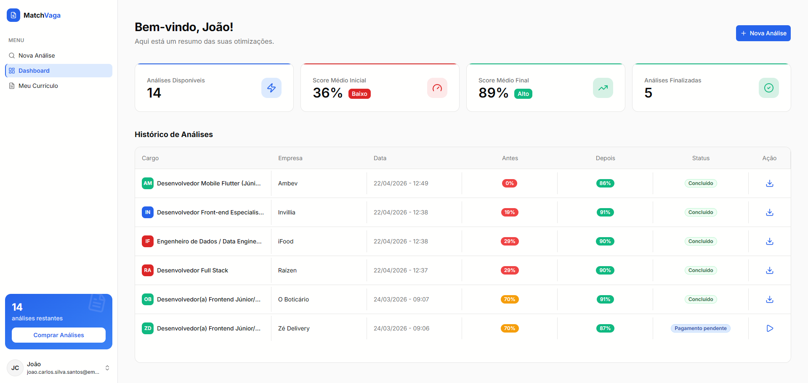
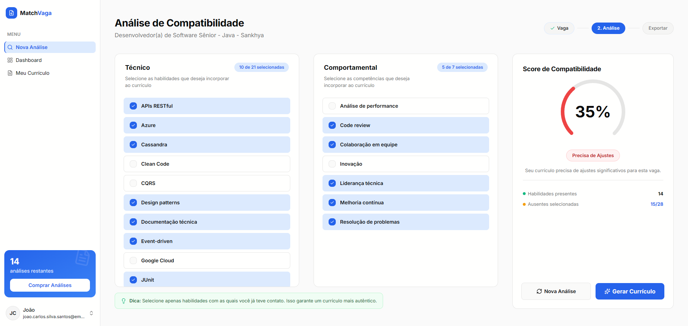
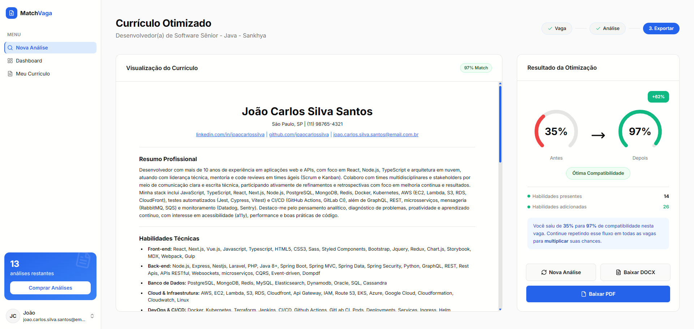
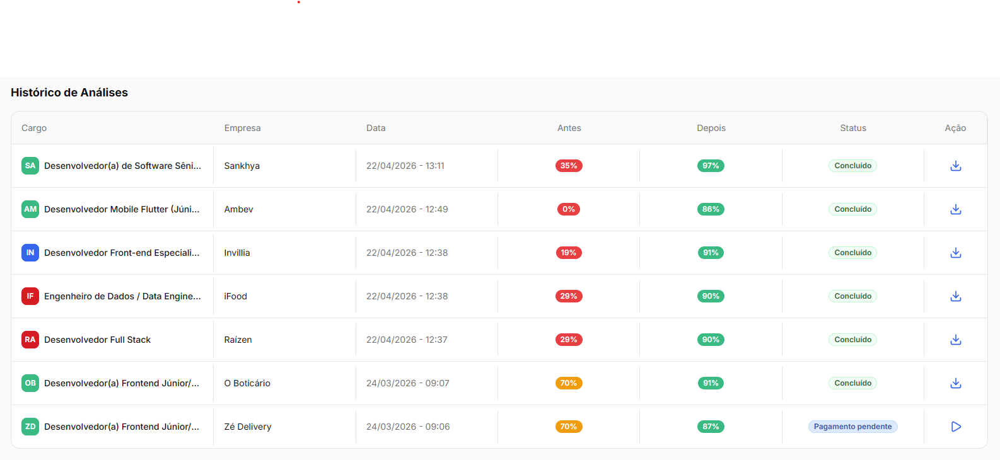

<h1 align="center">MatchVaga</h1>

<p align="center">
  <strong>Stop guessing why your resume gets ignored. See exactly what's missing, then fix it.</strong>
</p>

<p align="center">
  
  
  
  
  
  
</p>

---

## Overview

Job seekers apply to dozens of listings with the same generic resume and never learn why they get filtered out. Applicant tracking systems and recruiters scan for specific skills and keywords from the job description, and a resume that doesn't speak that language gets discarded before a human ever reads it.

MatchVaga is an AI-powered web app for Brazilian job seekers that closes that gap in three steps:

1. **Upload your resume once.** MatchVaga extracts your experience, education, and skills into structured data you can review and edit.
2. **Paste any job description.** The app extracts the required hard and soft skills and compares them against your profile, producing a compatibility score and a clear list of what's missing.
3. **Generate a tailored resume.** Using the gap analysis, MatchVaga rewrites and reorganizes your resume to highlight relevant experience and close keyword gaps, then exports it as a polished PDF or DOCX ready to send.

Every analysis is saved to a personal dashboard, so you can track how your compatibility score improves across applications. All UI copy is in Brazilian Portuguese.

## Screenshots

<table>
  <tr>
    <td></td>
    <td></td>
  </tr>
  <tr>
    <td align="center"><sub>Dashboard</sub></td>
    <td align="center"><sub>Compatibility analysis</sub></td>
  </tr>
  <tr>
    <td></td>
    <td></td>
  </tr>
  <tr>
    <td align="center"><sub>Optimized resume preview</sub></td>
    <td align="center"><sub>Analysis history</sub></td>
  </tr>
</table>

## Features

- **Resume import**: upload a PDF or DOCX and get structured, editable data back (contact, experience, education, skills, languages).
- **Job analysis**: paste any job posting; the hard and soft skills it actually asks for are extracted, and text that isn't a job description is rejected.
- **Gap analysis**: a compatibility score plus matched and missing skills, computed with normalized fuzzy matching against the resume.
- **Tailored resume**: a rewritten professional summary and hard skills regrouped by category for the specific vacancy, with a live preview before export.
- **Export**: download the optimized resume as PDF (`@react-pdf/renderer`) or DOCX (`docx`).
- **Credits and checkout**: pay per analysis or in bundles through Stripe Checkout; a signed webhook grants the credits and unlocks the document.
- **History**: every analysis is saved and revisitable from the dashboard.
- **Auth**: passwordless email OTP or Google OAuth via Supabase Auth.

## How it works

```
Upload resume   ->  Extract structured data      (Gemini)
                           |
Paste job post  ->  Extract required skills      (Claude Haiku)
                           |
                     Gap analysis + score         (deterministic)
                           |
                 Generate tailored resume         (Claude Sonnet)
                           |
                    Export as PDF / DOCX
```

The pipeline is multi-model on purpose: each step uses the model with the best cost and quality trade-off for that job, and the matching step is deterministic so the score is consistent and explainable.

| Step                         | Model                                                  | Why                                                  |
| ---------------------------- | ------------------------------------------------------ | ---------------------------------------------------- |
| Resume extraction and polish | Gemini 2.5 Flash Lite (falls back to Gemini 2.5 Flash) | Native PDF input, cheap, fast structured JSON output |
| Job skills extraction        | Claude Haiku 4.5                                       | Reliable structured extraction at low latency        |
| Skills matching              | Deterministic (normalization + string similarity)      | Reproducible, explainable score with no model cost   |
| Resume synthesis             | Claude Sonnet 4.6                                      | Highest quality writing for the user-facing output   |

Every model response is constrained by a JSON schema and validated with Zod before it touches the database, and resume extraction retries on the fallback model when the primary one fails.

## Tech stack

| Layer         | Technology                                                              |
| ------------- | ----------------------------------------------------------------------- |
| Framework     | Next.js 16 (App Router, Server Actions, React Compiler)                 |
| UI            | React 19, TypeScript (strict), Tailwind CSS v4, shadcn/ui, Radix UI     |
| Data and auth | Supabase (Postgres, Auth, Storage, Row Level Security)                  |
| AI            | Google Gemini (`@google/genai`), Anthropic Claude (`@anthropic-ai/sdk`) |
| Client data   | TanStack Query v5                                                       |
| Validation    | Zod                                                                     |
| Payments      | Stripe Checkout and webhooks                                            |
| Documents     | `@react-pdf/renderer`, `docx`, `mammoth`                                |
| Analytics     | PostHog (proxied through Next.js rewrites)                              |
| Tooling       | ESLint, Prettier, Vitest, Husky, lint-staged, Yarn                      |

## Architecture

- **Server Actions as the backend.** All mutations and AI calls go through Server Actions in `src/app/actions/`. Every action re-validates its input with Zod and re-authenticates the user on the server instead of trusting the client. The only API route is the Stripe webhook.
- **Server-only AI layer.** Prompts, JSON schemas, and model clients live in `src/lib/ai/` and never ship to the browser; provider API keys are read only on the server.
- **Row Level Security.** Every table (`resumes`, `analyses`, `optimized_documents`, `user_credits`, `purchases`) is scoped to `auth.uid()`, so data access is enforced at the database layer, not just in application code.
- **Isolated privileged path.** The Stripe webhook verifies the request signature before granting credits, and it is the only code path that uses the service role Supabase client.
- **Migrations in the repo.** The schema, RLS policies, and storage bucket policies are versioned in `supabase/migrations/`.
- **Structured logging.** Server-side errors (AI, database, Server Actions, API routes) are emitted as single-line JSON by `logServerError` in `src/lib/logger.ts`, with `context`, `operation`, and `model` fields that are easy to filter in Vercel's runtime logs.

## Project structure

```
src/
├── app/
│   ├── (auth)/          # Email OTP and Google login
│   ├── (legal)/         # Privacy policy and terms of service
│   ├── onboarding/      # How it works, resume upload, verify extracted data
│   ├── inicio/          # Dashboard, new analysis wizard, resume, checkout
│   ├── actions/         # Shared Server Actions (resume, analysis, preview, export, user)
│   └── api/webhooks/    # Stripe webhook
├── components/          # ui/ (shadcn primitives) and shared/ components
├── lib/
│   ├── ai/              # Model clients, prompts, JSON schemas
│   ├── document/        # PDF and DOCX generation, file validation
│   ├── stripe/          # Stripe clients
│   ├── supabase/        # Browser, server, and service Supabase clients
│   ├── analytics/       # PostHog events
│   └── query/           # TanStack Query client and options
├── schemas/             # Zod schemas for Server Action inputs
└── hooks/, contexts/, constants/, types/, utils/
supabase/
└── migrations/          # SQL schema and Row Level Security policies
```

Route-specific components, hooks, and utils are co-located in `_components/`, `_hooks/`, and `_utils/` folders next to the route that uses them.

## Getting started

### Prerequisites

- Node.js 20+
- Yarn
- A Supabase project with the migrations from `supabase/migrations/` applied
- API keys for Google AI Studio, Anthropic, and Stripe

### Installation

```bash
git clone https://github.com/11GravityDevs/matchvaga.git
cd matchvaga
yarn install
cp .env.example .env.local
```

Fill in `.env.local` following the comments in `.env.example` (Supabase, AI keys, Stripe, site URL, support email, and PostHog).

Then start the dev server:

```bash
yarn dev
```

Open [http://localhost:3000](http://localhost:3000).

## Scripts

| Command            | Description                           |
| ------------------ | ------------------------------------- |
| `yarn dev`         | Start the development server          |
| `yarn build`       | Production build                      |
| `yarn start`       | Serve the production build            |
| `yarn lint`        | Run ESLint with autofix               |
| `yarn format`      | Format with Prettier                  |
| `yarn check-types` | Type-check with `tsc`                 |
| `yarn test`        | Run the Vitest suite                  |
| `yarn find-unused` | Report unused exports with `ts-prune` |

## Code quality

A Husky pre-commit hook runs lint-staged (Prettier and ESLint on staged files) and then `tsc --noEmit`. The commit is blocked on any lint or type error. The skills matching logic is covered by unit tests in Vitest.

## License

This project is publicly viewable for portfolio purposes only. All rights are reserved and no reuse is permitted without written permission. See [LICENSE](LICENSE).
